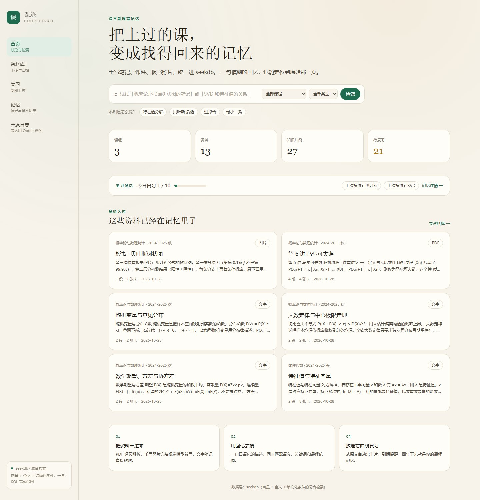

# 课迹 CourseTrail

把上过的课，变成找得回来的记忆。



课迹是一个跨学期的课堂记忆库：把手写笔记、课件 PDF、板书照片统一入库，用一句模糊的回忆就能定位到原始片段，再从原文自动生成复习卡、按遗忘曲线排期。

数据层基于 **seekdb**：同一张表上同时建向量索引和中文全文索引，一条 SQL 完成「语义 + 关键词 + 结构化过滤」的混合检索。

## 功能

- **多模态入库**：PDF 逐页解析并保留页码；图片可配视觉模型自动转写；文字笔记直接粘贴。所有原始文件都会保留，检索结果可点回原文。
- **混合检索**：`cosine_distance()` 与 `MATCH … AGAINST` 在同一条 SQL 中计算，应用层按 0.62 / 0.38 融合；弱相关结果会被阈值过滤。
- **来源可追溯**：每个片段都带资料、课程、页码，结果页直接打开原文件对应页。
- **间隔复习**：从原文片段生成问答卡（接入大模型时质量更高），四档评分后由 FSRS 计算下次到期时间，评分记录写回数据库。
- **学习记忆**：检索历史、每日目标、薄弱卡片与复习统计都写入 seekdb；首页直接显示上次搜过的词，复习页按目标算进度，重启后仍然接得上。
- **零依赖兜底**：没有配置 embedding / LLM 时，使用本地特征哈希向量与模板卡片，全流程依然可以跑通。

## 技术栈

| 层 | 选型 |
| --- | --- |
| 前端 + 后端 | Next.js 16（App Router / Route Handlers）+ TypeScript |
| 样式 | Tailwind CSS 4 |
| 数据库 | seekdb（Docker，MySQL 协议，HNSW + IK 全文索引） |
| 数据库驱动 | mysql2（参数化 SQL） |
| 文档解析 | pdfjs-dist |
| 复习算法 | ts-fsrs |
| 模型接口 | OpenAI 兼容的 embedding / chat / vision 接口（可选） |

## 快速开始

前置：Node.js 20+、Docker。

```bash
# 1. 启动 seekdb
docker compose up -d

# 2. 安装依赖
npm install

# 3. 建库建表
npm run db:init

# 4. 灌入示例课程（3 门课、12 份资料、32 张卡片）
npm run db:seed

# 5. 启动
npm run dev
```

打开 http://localhost:3000 。

如果 Docker Hub 拉取超时，可先给 Docker 配置镜像加速，或直接拉取镜像后重命名：

```bash
docker pull <你的镜像源>/oceanbase/seekdb:latest
docker tag <你的镜像源>/oceanbase/seekdb:latest oceanbase/seekdb:latest
```

### 接入真实模型（可选）

复制 `.env.example` 为 `.env.local`，填入 OpenAI 兼容接口：

```bash
EMBEDDING_API_URL=https://api.siliconflow.cn/v1
EMBEDDING_API_KEY=sk-xxx
EMBEDDING_MODEL=BAAI/bge-m3
EMBEDDING_DIM=1024

LLM_API_URL=https://api.deepseek.com/v1
LLM_API_KEY=sk-xxx
LLM_MODEL=deepseek-chat

# 支持图片输入的多模态模型，用于转写手写笔记
VISION_MODEL=qwen-vl-max
```

不配置时自动使用本地兜底方案，功能不受影响。

## 检索是怎么做的

核心在 `src/lib/search.ts`：先把查询文本转向量，再在 seekdb 里一条 SQL 同时得到余弦距离与全文相关度：

```sql
SELECT * FROM (
  SELECT c.id, c.content, c.page_no,
         cosine_distance(c.embedding, ?) AS dist,
         MATCH(c.content) AGAINST(?) AS rel
  FROM chunks c
  JOIN materials m ON m.id = c.material_id
  JOIN courses co ON co.id = c.course_id
  WHERE c.course_id = ?            -- 结构化条件直接下推
) t
ORDER BY 0.62 * (CASE WHEN t.dist < 1 THEN 1 - t.dist ELSE 0 END)
       + 0.38 * (CASE WHEN t.rel >= 0.6 THEN t.rel / (t.rel + 1) ELSE 0 END) DESC
LIMIT ?
```

- 向量召回负责「说法不一样但意思相近」
- 全文召回负责「公式名、方法名、专有名词」
- 标量条件负责「哪门课、哪类资料」

纯全文会把「贝叶斯」拆散到无关片段，纯向量又找不到精确术语，所以两者缺一不可。

## 评测

```bash
npm run eval
```

脚本会对比纯向量、纯全文、混合检索的 Recall@5。当前示例库（26 个片段）使用本地哈希向量时三种方式都很高，因为语料小且查询含强关键词；接入 bge-m3 后语义召回的差异会更明显。

## 目录

```
src/
  app/                 页面与 Route Handlers
    api/               search / materials / cards / files / courses / stats
    page.tsx           首页
    search/            检索结果
    library/           资料库与上传
    review/            复习
    memory/            学习记忆（检索历史、目标、薄弱卡片）
    devlog/            开发日志
  components/          Nav / SearchForm / UploadPanel / ReviewBoard / Highlight
  lib/
    schema.ts          seekdb 建表语句
    ingest.ts          PDF / 图片 / 文字入库管线
    search.ts         混合检索与融合排序
    cards.ts           FSRS 排期
    memory.ts          检索历史、偏好与复习统计
    embed.ts           远程 embedding + 本地哈希兜底
    llm.ts             概念抽取 / 卡片生成 / 图片转写
scripts/
  init-db.ts           建库建表
  seed.ts              示例数据
  eval.ts              检索评测
docs/devlog/           开发过程记录
```

## 已知限制

- 扫描版 PDF 无法直接抽取文字，需要上传关键页照片或补充说明。
- 未配置视觉模型时，图片资料依赖手填的补充说明参与检索。
- 当前是单用户本地部署，没有做账号体系。
- 修改 `EMBEDDING_DIM` 需要重建 `chunks` 表。

## 比赛说明

- 作品网站（公开）：https://coursetrail-ukrnh1e2s5p.qoder.zone
- 代码仓库（公开）：https://github.com/Pureiriss/coursetrail
- 开发全程在 Qoder 内完成，过程记录见 [`docs/devlog/2026-10-28.md`](docs/devlog/2026-10-28.md)、[`docs/qoder-record.md`](docs/qoder-record.md) 与站内 `/devlog` 页面。
- 指定技术选择 **seekdb**，承担数据存储、全文/向量检索与复习状态读写；未使用 PowerContext。
- 提交材料：[提交清单](docs/submission.md) · [验证样例](docs/verification.md) · [Qoder 开发记录](docs/qoder-record.md)。
